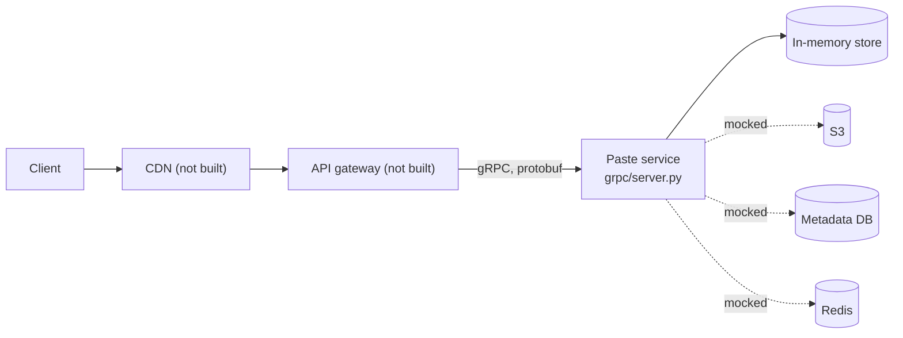
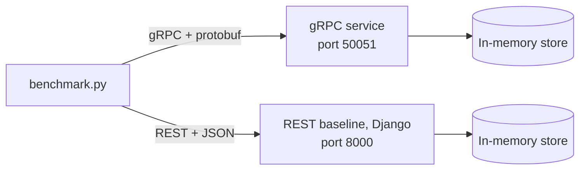
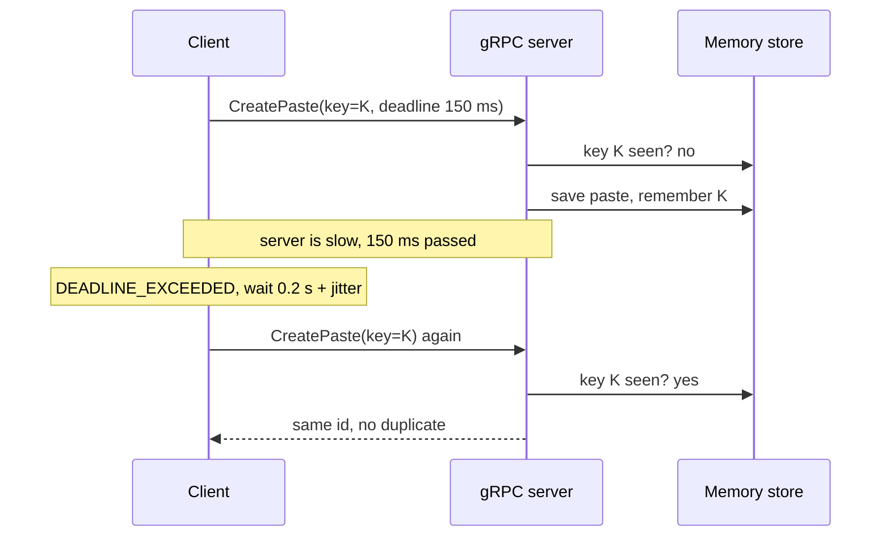

# Pastebin: Protocol Implementation (SIS #2)

This repo implements the **Paste service** from SIS #1 (Pastebin) with **gRPC (HTTP/2 + protobuf)**.
The service supports idempotency, timeouts and retries.
A REST/JSON service (Django) is used as a **baseline** for latency and payload size measurements.

Language: Python.

Operations: `CreatePaste`, `GetPaste`, `UpdatePaste`, `DeletePaste`.

## Why gRPC

Pastebin is read-heavy (1,000 RPS read, 50 RPS write) and has a latency goal of p99 < 150 ms.

1. **Latency.** In our measurements gRPC is about 3 times faster than REST/JSON at p50
   (0.17 ms vs 0.52 ms for a 1 KB text, 0.79 ms vs 2.50 ms for a 1 MB text).
   This saves latency budget for the slower parts: S3 (~80 ms) and the network.
2. **Timeouts and retries are built in.** Every gRPC call has a deadline.
   Status codes like `UNAVAILABLE` and `DEADLINE_EXCEEDED` show which errors are safe to retry,
   and codes like `NOT_FOUND` or `PERMISSION_DENIED` show which are not.
3. **One contract.** `paste.proto` describes all operations and messages.
   Client and server code is generated from it, so services cannot go out of sync.
4. **HTTP/2.** Many calls go through one connection. This fits internal calls
   between the API gateway and the services, where there is no browser.

WebSocket is not needed: Pastebin has no real-time updates.

## Architecture



Solid lines are implemented. Dotted lines and parts marked "not built" are mocked.

## Benchmark setup



Both services use the same in-memory storage and the same logic.
So the benchmark compares the protocols, not the databases.

## What is implemented and what is mocked

| Part | Status |
|---|---|
| Create / Get / Update / Delete | implemented |
| Idempotency key for create | implemented |
| Timeout (deadline 150 ms) | implemented in `client.py` |
| Retry (3 attempts, backoff + jitter) | implemented in `client.py` |
| TTL check on read, soft delete | implemented |
| Size limit 1 MB | implemented |
| Login / JWT | mocked: `user_id` is sent in the request |
| S3, metadata DB, Redis | mocked: in-memory dict |
| CDN, API gateway, Auth service | not built |
| Cleanup worker | not built: expired pastes are hidden on read |

## Idempotency, timeouts and retries

**Idempotency.** `CreatePaste` is not idempotent by itself: a retry after a timeout could create a duplicate.
The client sends a unique `idempotency_key` (uuid) with the request.
The server saves `key -> id`. If the same key comes again, the server returns the same id
and does not create a new paste. `GetPaste`, `UpdatePaste` and `DeletePaste` are idempotent by nature.

**Timeout.** Every call has a deadline of 150 ms (our p99 goal).

**Retry.** Only for `UNAVAILABLE` and `DEADLINE_EXCEEDED`. Maximum 3 attempts.
The wait time is 0.2 s, 0.4 s, ... plus random jitter (exponential backoff).
The same idempotency key is used in all attempts.
Errors like `NOT_FOUND`, `PERMISSION_DENIED` and `INVALID_ARGUMENT` are not retried.



## Error mapping

| Case | gRPC status | REST baseline status |
|---|---|---|
| Paste not found | NOT_FOUND | 404 |
| Paste expired or deleted | NOT_FOUND (message differs) | 410 |
| No login | UNAUTHENTICATED | 401 |
| Not your paste | PERMISSION_DENIED | 403 |
| Text bigger than 1 MB | INVALID_ARGUMENT | 413 |

gRPC has no "410 Gone" status, so expired and deleted pastes return NOT_FOUND with a different message.

## Project structure

```
.
├── README.MD
├── requirements/
│   └── dev.txt
├── grpc/
│   ├── paste.proto          # contract
│   ├── paste_pb2.py         # generated
│   ├── paste_pb2_grpc.py    # generated
│   ├── server.py            # gRPC Paste service
│   ├── client.py            # client with timeout, retry, idempotency key
│   └── benchmark.py         # gRPC vs REST measurements
├── manage.py
├── pastebin/                # Django project
└── apps/pastes/             # Django app (views, urls, in-memory store)
```

## How to run

```bash
pip install -r requirements/dev.txt
```

**Terminal 1: gRPC server**
```bash
cd grpc
python server.py
```

**Terminal 2: REST baseline (Django)**
```bash
cd ..
waitress-serve --host=127.0.0.1 --port=8000 pastebin.wsgi:application
```

**Terminal 3: client demo and benchmark**
```bash
cd grpc
python client.py
python benchmark.py
```

If you change `paste.proto`, generate the code again:
```bash
python -m grpc_tools.protoc -I. --python_out=. --grpc_python_out=. paste.proto
```

### Test timeout, retry and idempotency

Start the gRPC server with a fake delay:
```bash
DELAY_FIRST=0.3 python server.py
```
(Windows PowerShell: `$env:DELAY_FIRST="0.3"; python server.py`)

The first create takes 0.3 s, so the client gets `DEADLINE_EXCEEDED` and retries with the same key.
The server log shows only one `created paste` line, so there is no duplicate.
Restart the server without `DELAY_FIRST` before running the benchmark.

## Results

Everything runs on localhost.
500 GET requests per case after 100 warmup requests.

### Payload size (bytes)

| Text size | gRPC request | JSON request | gRPC response | JSON response |
|---|---|---|---|---|
| 1 KB | 1048 | 1053 | 1015 | 1067 |
| 10 KB | 10048 | 10053 | 10015 | 10067 |
| 100 KB | 100049 | 100053 | 100016 | 100067 |
| 1 MB | 1000049 | 1000053 | 1000016 | 1000067 |

### GET latency (ms)

| Text size | Protocol | p50 | p95 | p99 |
|---|---|---|---|---|
| 1 KB | gRPC | 0.18 | 0.25 | 0.34 |
| 1 KB | REST | 0.56 | 0.88 | 1.07 |
| 10 KB | gRPC | 0.18 | 0.24 | 0.35 |
| 10 KB | REST | 0.57 | 0.89 | 1.19 |
| 100 KB | gRPC | 0.22 | 0.29 | 0.38 |
| 100 KB | REST | 0.77 | 1.13 | 1.27 |
| 1 MB | gRPC | 0.80 | 1.13 | 1.37 |
| 1 MB | REST | 2.68 | 3.32 | 4.77 |

## Conclusions

- **Payload size:** protobuf and JSON are almost the same size. The gRPC response is 52 bytes smaller
  (about 5% for a 1 KB text, almost 0% for 1 MB), because a paste is mostly text.
  Size is not a reason to choose gRPC for this service.
- **Latency:** gRPC is about 3 times faster at p50 for all sizes
  (for example 0.17 ms vs 0.52 ms for 1 KB, 0.79 ms vs 2.50 ms for 1 MB).
  The p99 value is the 5th slowest of 500 requests, so it is noisy. We rely on p50 and p95.
- **Requirement p99 < 150 ms:** both protocols are far below the goal.
  The slowest case (REST, 1 MB) has p99 = 4.77 ms.
- **In the real system:** S3 (~80 ms) and the network (~30 ms) cost much more than the protocol
  difference (1-4 ms). The protocol alone will not decide the total latency.
- **Decision:** the Paste service uses gRPC. It has lower latency in our measurements,
  built-in deadlines and status codes for timeouts and retries, and one `.proto` contract
  for all services.

## Limitations

- Everything runs on localhost, so there is no real network delay.
- Storage is in memory, there is no real S3 or database. Data is lost on restart.
- Requests are sent one by one, without parallel load.
- Only GET is measured.
- Payload size is measured for the body only, without HTTP headers.
- The latency difference includes the frameworks (grpc-python vs Django + JSON),
  not only the protocols.
- Login is mocked: `user_id` is passed in the request instead of a JWT.